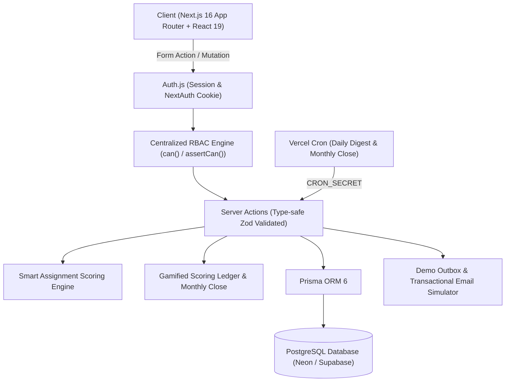

# Waypoint 🧭

> **Precision task assignment and delivery tracking built for tech leads who need to assign work to developers and get projects shipped on time.**

[](https://github.com/waypoint/waypoint/actions)
[](https://www.typescriptlang.org/)
[](https://nextjs.org/)
[](https://react.dev/)
[](https://www.prisma.io/)
[](https://tailwindcss.com/)

---

## 🎯 The Problem

Engineering leads struggle with fragmented tooling:

- **Jira / Linear** track issues, but don't tell leads _who actually has bandwidth or the right skill profile_ to take on a task without burning out.
- **Spreadsheets & Gut Feeling** lead to uneven work distribution, hidden bottlenecks, and subjective performance evaluations.
- **Developers** feel demotivated when review bounces, scope creep, and late deliveries are tracked opaquely.

**Waypoint** replaces guesswork with a transparent, unified workspace featuring mathematical assignment suggestions, balanced capacity tracking, real-time dependency risk analysis, and a transparent, audit-ready developer scoring ledger.

---

## 🏗️ System Architecture



---

## 🚀 Key Features

### 1. 🤖 Precision Smart Assignment

When creating or reassigning a task, Waypoint ranks candidate developers using an objective heuristic algorithm:

- **Skill Match (0–40 pts)**: Overlap between task required skill tags and developer verified skills.
- **Available Capacity (0–30 pts)**: Remaining story points against individual capacity limits (default: 20 pts max).
- **Historical Velocity (0–20 pts)**: Recent on-time completion percentage over the last 30 days.
- **Affinity (0–10 pts)**: Prior task completions within the same project.
- **Availability Penalty**: Automatic exclusion or penalty for members on leave (`ON_LEAVE`) or busy (`BUSY`).
- **Explainable AI**: Provides plain-language rationale for every recommendation (e.g. _"Matches 2/2 skills • 4/20 pts open capacity • 94% on-time record"_).

### 2. ⚖️ Fair Gamified Scoring Ledger

Waypoint turns task delivery into a transparent, gamified experience without unfair penalties:

- **Mathematical Formula**:
  $$\text{Final Points} = \max\left(0.5 \times \text{Base}, (\text{Base} \times \text{TimingMultiplier}) - \text{BounceDeductions}\right)$$
  - $\text{Base Points} = \text{Estimate Points} \times \text{Priority Multiplier}$ (`LOW` 1.0x, `MEDIUM` 1.2x, `HIGH` 1.5x, `URGENT` 2.0x).
  - **On-time Completion**: $+20\%$ bonus (multiplier $1.2\times$).
  - **Late Completion**: $-50\%$ penalty (multiplier $0.5\times$).
  - **Review Bounces**: $-10\%$ of base points each time a task is returned from `IN_REVIEW` to `IN_PROGRESS` (capped at $50\%$ maximum deduction).
- **Audit-Ready Score Events**: Every point addition or deduction creates an immutable record tied to the task, user, and sprint.
- **Automated Month-End Close**: Finalizes rankings into monthly results, resets monthly streaks, and awards commemorative system badges.

### 3. 📊 Unified Multi-View Workspace

Switch between multiple views with instant state persistence:

- **Kanban Board**: Drag-and-drop workflow (`BACKLOG`, `TODO`, `IN_PROGRESS`, `IN_REVIEW`, `DONE`) with column WIP limits, assignee avatars, and priority badges.
- **List View**: Dense, tabular view with sorting by due date, priority, or points, multi-filter dropdowns, and batch actions.
- **Timeline / Gantt View**: Visual sprint roadmap mapping task durations, milestones, and critical dependency links.
- **Calendar View**: Day, week, and month scheduling grids with drag-to-reschedule.
- **My Tasks**: Focused personal view for developers showing active tasks, checklists, time logging, and blocked reasons.

### 4. 🧭 Tech Lead Command Center

- **Workload Balancer**: Real-time team capacity meters (Underutilized, Balanced, Near Limit, Overloaded).
- **Sprint Burndown**: Live charts comparing ideal velocity against actual points completed.
- **Dependency Graph**: Interactive network graph showing blocked paths, circular dependencies, and critical chains.
- **Blocked Alerts**: Instant banner notifications when a task is flagged as blocked or exceeds its due date.

### 5. 🏆 Leaderboard & Badges

- **Monthly Standings**: Live developer rankings sorted by total points earned, on-time delivery rate, and completed task count.
- **System Badges**:
  - 🚀 **Speed Demon**: 5 consecutive on-time deliveries.
  - 🎯 **Perfectionist**: Completed 10 tasks with 0 review bounces.
  - 🏋️ **Heavy Lifter**: Closed 30+ estimate points in a single sprint.
  - 🛡️ **Unblocker**: Resolved 3+ blocked tasks.
  - 🏆 **Monthly MVP**: Rank #1 on the closed monthly leaderboard.

### 6. 📬 Notifications & Demo Outbox

- In-app notification center for mentions, assignments, reviews, and blocking alerts.
- Automated daily digest emails and month-end close summaries via Vercel Cron.
- **Built-in Demo Outbox**: View simulated verification emails, password resets, and digest notifications directly inside the browser without configuring third-party SMTP.

### 7. ⌨️ Global Command Palette & Shortcuts

Press **`Cmd + K`** (or `Ctrl + K`) anywhere to search tasks, jump across views, toggle dark mode, or trigger quick actions.

| Shortcut               | Action                             |
| :--------------------- | :--------------------------------- |
| `Cmd + K` / `Ctrl + K` | Open Global Command Palette        |
| `?`                    | Show Keyboard Shortcut Cheat Sheet |
| `C`                    | Create New Task                    |
| `G` then `B`           | Navigate to Kanban Board           |
| `G` then `M`           | Navigate to My Tasks               |
| `G` then `L`           | Navigate to Leaderboard            |
| `G` then `R`           | Navigate to Reports & Analytics    |
| `G` then `W`           | Navigate to Workload Balancer      |
| `G` then `A`           | Navigate to Audit Log              |
| `G` then `D`           | Open Demo Outbox                   |

---

## 👥 Demo Accounts

Waypoint comes pre-seeded with realistic engineering profiles. Use the **1-click login buttons** on the landing page or enter credentials manually:

| Persona                  | Email                     | Password   | Role        | Description                                                                                        |
| :----------------------- | :------------------------ | :--------- | :---------- | :------------------------------------------------------------------------------------------------- |
| **Tech Lead (Admin)**    | `techlead@waypoint.demo`  | `demo1234` | `ADMIN`     | Full administrative control, task assignment, workload balancer, audit log, and sprint management. |
| **Fullstack Developer**  | `developer@waypoint.demo` | `demo1234` | `DEVELOPER` | Sarah Chen: assigned tasks, checklist management, time tracking, and score events.                 |
| **Backend Developer**    | `alex@waypoint.demo`      | `demo1234` | `DEVELOPER` | Alex Rivera: active backend engineer working on auth and data migrations.                          |
| **Viewer / Stakeholder** | `viewer@waypoint.demo`    | `demo1234` | `VIEWER`    | Read-only access to sprint roadmaps, reports, and leaderboards.                                    |

---

## 🛠️ Tech Stack & Architecture

| Layer              | Technology                            | Details                                                          |
| :----------------- | :------------------------------------ | :--------------------------------------------------------------- |
| **Framework**      | Next.js 16 (App Router)               | Server Components, Server Actions, Dynamic Route Handlers        |
| **Runtime**        | React 19 + TypeScript (Strict)        | Concurrent mode, hook actions, zero any types                    |
| **Styling**        | Tailwind CSS + Design Tokens          | Notion-inspired visual language, Google Stitch MCP design system |
| **Database**       | PostgreSQL + Prisma ORM 6             | Multi-tenant schema with relations, indexes, and cascades        |
| **Authentication** | Auth.js (NextAuth v5)                 | Credentials authentication + Google OAuth + Session cookies      |
| **State & Data**   | TanStack Query + React Hook Form      | Optimistic UI updates, caching, client-side validation with Zod  |
| **Drag & Drop**    | `@dnd-kit/core` & `@dnd-kit/sortable` | Accessible Kanban board interactions                             |
| **Testing**        | Vitest                                | 23 test suites, 140 passing unit & integration tests             |
| **Scheduling**     | Vercel Cron                           | Automated daily digest delivery & monthly leaderboard close      |

---

## 🏁 Getting Started

### Prerequisites

- **Node.js**: `v22.x` or higher
- **npm**: `v10.x` or higher
- **PostgreSQL**: Local Postgres, Neon, or Supabase instance

### Quick Setup

1. **Clone the repository:**

   ```bash
   git clone https://github.com/waypoint/waypoint.git
   cd Waypoint
   ```

2. **Install dependencies:**

   ```bash
   npm install
   ```

3. **Configure environment variables:**

   ```bash
   cp .env.example .env.local
   ```

   _(Update `DATABASE_URL` with your PostgreSQL connection string)._

4. **Initialize database schema & run seed script:**

   ```bash
   # Push schema to database
   npx prisma db push

   # Seed database with Acme Engineering, 7 users, 2 projects, 40+ tasks, scores & badges
   npm run seed
   ```

5. **Start local development server:**
   ```bash
   npm run dev
   ```
   Open [http://localhost:3000](http://localhost:3000) to view Waypoint.

---

## 🧪 Testing & Quality Gates

Waypoint is built under strict automated test coverage and quality verification:

```bash
# Run all 140 unit and integration tests across 23 test suites
npm test

# Run strict TypeScript compiler verification (0 errors)
npm run typecheck

# Run ESLint rules check (0 errors, 0 warnings)
npm run lint

# Check code formatting with Prettier
npm run format:check

# Produce optimized production build
npm run build
```

---

## 🚀 Deployment to Vercel

Waypoint is pre-configured for one-click deployment on [Vercel](https://vercel.com):

1. **Push your repository** to GitHub, GitLab, or Bitbucket.
2. **Import project** into the Vercel Dashboard.
3. **Configure Environment Variables** in Project Settings:
   - `DATABASE_URL`: Connection string to your PostgreSQL database (e.g. Neon, Supabase).
   - `AUTH_SECRET`: Random 32-character secret generated via `openssl rand -base64 32`.
   - `AUTH_URL`: Your production URL (e.g. `https://waypoint.vercel.app`).
   - `CRON_SECRET`: Random string protecting `/api/cron/*` endpoints.
   - `NEXT_PUBLIC_DEMO_MODE`: Set to `"true"` to enable 1-click demo personas and Demo Outbox.
   - `NEXT_PUBLIC_APP_URL`: Production application base URL.
4. **Deploy**: Vercel will automatically build the project and deploy the scheduled cron jobs defined in `vercel.json`.

---

## 📄 License

MIT © [Waypoint Engineering Team](https://github.com/waypoint/waypoint)
